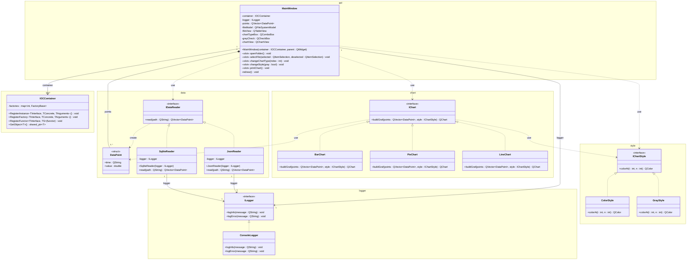
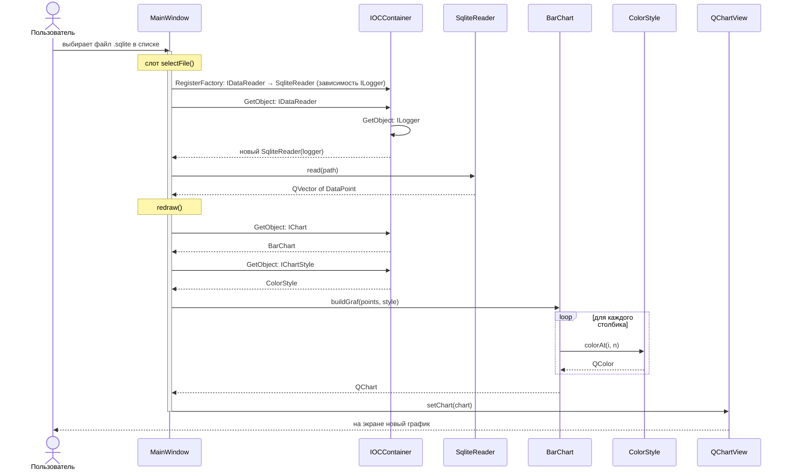
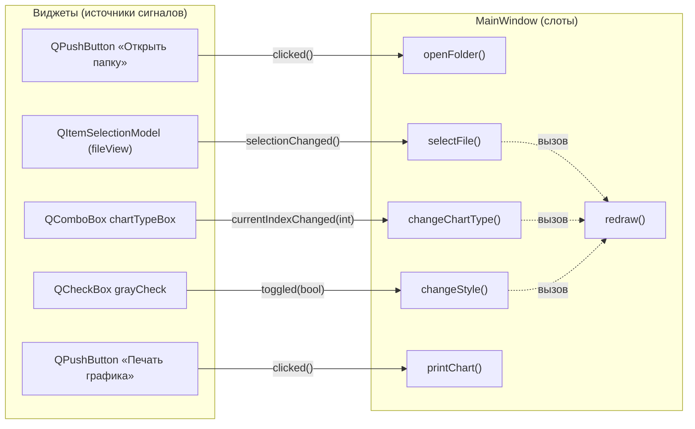

# Документация к лабораторной работе: печать графиков

Приложение на C++/Qt для построения графиков по данным из файлов и печати их в PDF. Разработано в рамках курса «Технологии программирования» (4 курс, 2 семестр).

## Описание

Пользователь выбирает папку и файл с данными. Программа не показывает сами данные, а строит по ним график. Тип графика (столбчатая, круговая или линейная диаграмма) и стиль (цветной или чёрно-белый) можно менять. Готовый график сохраняется в PDF, место сохранения выбирает пользователь.

Связность архитектуры снижена с помощью принципа внедрения зависимостей. Зависимости внедряются через IoC-контейнер.

## Требования по заданию

1. Реализовать внедрение зависимостей с помощью IoC-контейнера.
2. Предусмотреть добавление новых графиков (графики отличаются видом и данными).
3. Предусмотреть изменение визуального стиля графиков (цветной, чёрно-белый).
4. Загружать данные, выбирая нужный файл. Данные не отображать, отображать только график.
5. При печати в PDF давать выбрать место сохранения.

## Технологии

- Qt 5 (модули Widgets, Charts, Sql)
- C++17
- CMake 3.16 / qMake

## Формат входных данных

Данные — набор пар `[дата, значение]`.

**SQLite** (`.sqlite`) — из базы читается первая таблица со столбцами `Time` и `Value`:

```sql
CREATE TABLE [HUMIDITY_MOSCOW] ([Time] Datetime, [Value] Float)
```

**JSON** (`.json`) — массив точек с полями `time` (строка) и `value` (число):

```json
[
  { "time": "01.2024", "value": -14.2 },
  { "time": "02.2024", "value": -12.5 }
]
```

## Структура проекта

```
widgets/
├── main.cpp      точка входа: регистрация реализаций по умолчанию в IoC-контейнере
├── ioc/          IoC-контейнер
├── logger/       логирование
├── data/         точки данных и чтение файлов
├── style/        визуальные стили графиков
├── chart/        виды графиков
├── gui/          главное окно
├── docs/         исходники UML-диаграмм (.mmd)
└── test_data/    тестовые данные и тест-кейсы
```

## Архитектура

- `ioc/`
  - `IOCContainer` — IoC-контейнер: хранит для каждого интерфейса фабрику его реализации
- `logger/`
  - `ILogger` — абстрактный интерфейс логирования
  - `ConsoleLogger` — реализация, выводящая сообщения в консоль
- `data/`
  - `DataPoint` — одна точка данных `[дата, значение]`; `groupPoints` — сжатие большого числа точек в группы
  - `IDataReader` — интерфейс чтения данных из файла
  - `SqliteReader` — чтение из базы SQLite
  - `JsonReader` — чтение из JSON-файла
- `style/`
  - `IChartStyle` — интерфейс визуального стиля графика
  - `ColorStyle` — цветной стиль
  - `GrayStyle` — чёрно-белый стиль (оттенки серого)
- `chart/`
  - `IChart` — интерфейс графика
  - `BarChart` — столбчатая диаграмма
  - `PieChart` — круговая диаграмма
  - `LineChart` — линейный график
- `gui/`
  - `MainWindow` — главное окно: список файлов, настройки и область графика

### Внедрение зависимостей

`MainWindow` работает только с интерфейсами `IDataReader`, `IChart` и `IChartStyle` и не создаёт конкретные классы сама. Реализации регистрируются в `IOCContainer`, а окно получает их через `GetObject`:

| Действие пользователя        | Что регистрируется в контейнере                          |
|------------------------------|----------------------------------------------------------|
| запуск программы (`main`)    | `ILogger` → `ConsoleLogger`, `IChart` → `BarChart`, `IChartStyle` → `ColorStyle` |
| выбор файла `.sqlite`        | `IDataReader` → `SqliteReader` (с внедрённым `ILogger`)  |
| выбор файла `.json`          | `IDataReader` → `JsonReader` (с внедрённым `ILogger`)    |
| выбор типа диаграммы         | `IChart` → `BarChart` / `PieChart` / `LineChart`         |
| галочка «Черно-белый график» | `IChartStyle` → `GrayStyle` / `ColorStyle`               |

Перерисовка графика (`redraw`) берёт из контейнера текущие `IChart` и `IChartStyle` и вызывает `buildGraf`.

### Как добавить новый график

1. Создать в папке `chart/` класс-наследник `IChart` и реализовать в нём `buildGraf`.
2. Добавить название в список `chartTypeBox` и одну ветку `RegisterFactory<IChart, НовыйГрафик>()` в `MainWindow::changeChartType`.

Новый стиль или формат файла добавляется так же: наследник `IChartStyle` или `IDataReader` и одна регистрация в контейнере.

## Сборка

### Qt Creator (qMake)

Открыть файл `widgets.pro` в Qt Creator и собрать проект.

### CMake

```bash
mkdir build && cd build
cmake .. -DCMAKE_PREFIX_PATH=<путь к Qt>/5.15.0/mingw81_64
cmake --build .
```

## Использование

1. Нажать «Открыть папку» и выбрать папку с данными (например, `test_data`).
2. Выбрать файл `.sqlite` или `.json` в списке слева — справа построится график.
3. В списке «Выберите тип диаграммы» выбрать `BarChart`, `PieChart` или `LineChart`.
4. Галочкой «Черно-белый график» переключить стиль.
5. Нажать «Печать графика» и выбрать, куда сохранить PDF.

В статус-баре выводится имя файла и число точек или сообщение об ошибке. Подробный лог пишется в консоль.

Чтобы график оставался читаемым, для столбчатой и круговой диаграмм точки усредняются до 10 групп, для линейного графика — до 1000. В круговой диаграмме берётся модуль значения, потому что сектор не может быть отрицательным.

## UML-диаграммы

Исходники диаграмм лежат в папке [`docs`](docs).

### Диаграмма классов

Классы сгруппированы по папкам проекта. Исходник: [`docs/class_diagram.mmd`](docs/class_diagram.mmd)



Обозначения: `<|..` — реализация интерфейса, `*--` — композиция (агрегат владеет частью),
`-->` — направленная ассоциация, `..>` — зависимость; в кавычках указана кратность концов связей.

### Диаграмма последовательности

Сценарий «выбор файла → построение графика»: окно регистрирует реализацию в контейнере, получает объекты через `GetObject` и строит график, не зная конкретных классов. Исходник: [`docs/sequence_diagram.mmd`](docs/sequence_diagram.mmd)



### Диаграмма сигналов и слотов

Сплошная стрелка — `connect(сигнал → слот)`, пунктир — прямой вызов метода. Исходник: [`docs/signal_slot.mmd`](docs/signal_slot.mmd)



| Источник (сигнал)                         | Приёмник (слот)               |
|-------------------------------------------|-------------------------------|
| `folderButton::clicked()`                 | `MainWindow::openFolder`      |
| `QItemSelectionModel::selectionChanged()` | `MainWindow::selectFile`      |
| `chartTypeBox::currentIndexChanged(int)`  | `MainWindow::changeChartType` |
| `grayCheck::toggled(bool)`                | `MainWindow::changeStyle`     |
| `printButton::clicked()`                  | `MainWindow::printChart`      |

## Тестирование

Пользовательские тест-кейсы описаны в [`test_data/README.md`](test_data/README.md).
