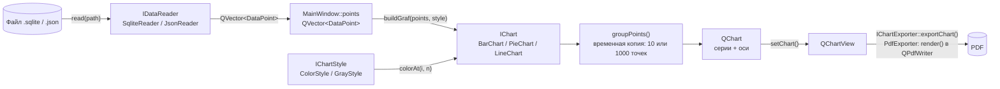
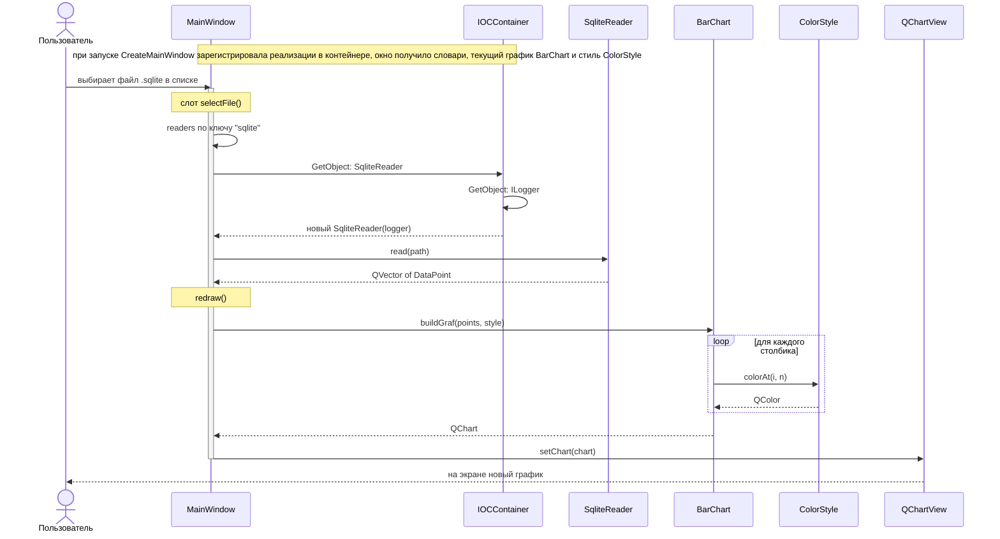
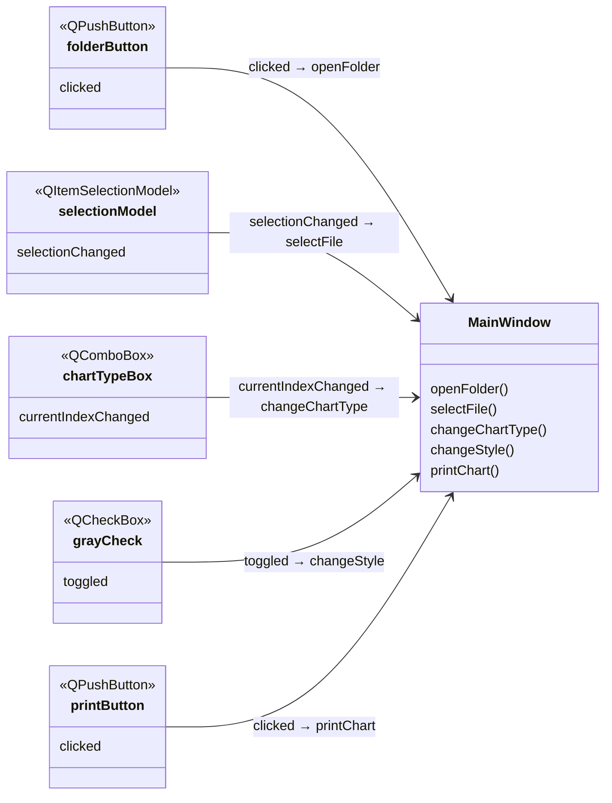

# Документация к лабораторной работе: печать графиков

Приложение на C++/Qt для построения графиков по данным из файлов и печати их в PDF. Разработано в рамках курса «Технологии программирования» (4 курс, 2 семестр).

## Описание

Пользователь выбирает папку и файл с данными. Программа не показывает сами данные, а строит по ним график. Тип графика (столбчатая, круговая или линейная диаграмма) и стиль (цветной или чёрно-белый) можно менять. Готовый график сохраняется в PDF, место сохранения выбирает пользователь.

Связность архитектуры снижена с помощью принципа внедрения зависимостей. Зависимости внедряются через IoC-контейнер.

## Требования по заданию

1. Реализовать внедрение зависимостей с помощью IoC-контейнера.
2. Предусмотреть добавление новых графиков (графики отличаются видом и данными).
3. Предусмотреть изменение визуального стиля графиков (цветной, чёрно-белый).
4. Загружать данные, выбирая нужный файл. Данные не отображать, отображать только график.
5. При печати в PDF давать выбрать место сохранения.

## Технологии

- Qt 5 (модули Widgets, Charts, Sql)
- C++17
- CMake 3.16 / qMake

## Формат входных данных

Данные — набор пар `[дата, значение]`.

**SQLite** (`.sqlite`) — из базы читается первая таблица со столбцами `Time` и `Value`:

```sql
CREATE TABLE [HUMIDITY_MOSCOW] ([Time] Datetime, [Value] Float)
```

**JSON** (`.json`) — массив точек с полями `time` (строка) и `value` (число):

```json
[
  { "time": "01.2024", "value": -14.2 },
  { "time": "02.2024", "value": -12.5 }
]
```

## Структура проекта

```
widgets/
├── main.cpp      точка входа: создаёт IoC-контейнер и главное окно
├── ioc/          IoC-контейнер
├── logger/       логирование
├── data/         точки данных и чтение файлов
├── style/        визуальные стили графиков
├── chart/        виды графиков
├── exporter/     сохранение графика в файл (PDF)
├── gui/          главное окно и точка композиции
└── test_data/    тестовые данные и тест-кейсы
```

## Архитектура

- `ioc/`
  - `IOCContainer` — IoC-контейнер: хранит для каждого интерфейса фабрику его реализации
- `logger/`
  - `ILogger` — абстрактный интерфейс логирования
  - `ConsoleLogger` — реализация, выводящая сообщения в консоль
- `data/`
  - `DataPoint` — одна точка данных `[дата, значение]`; `groupPoints` — сжатие большого числа точек в группы
  - `IDataReader` — интерфейс чтения данных из файла
  - `SqliteReader` — чтение из базы SQLite
  - `JsonReader` — чтение из JSON-файла
- `style/`
  - `IChartStyle` — интерфейс визуального стиля графика
  - `ColorStyle` — цветной стиль
  - `GrayStyle` — чёрно-белый стиль (оттенки серого)
- `chart/`
  - `IChart` — интерфейс графика
  - `BarChart` — столбчатая диаграмма
  - `PieChart` — круговая диаграмма
  - `LineChart` — линейный график
- `exporter/`
  - `IChartExporter` — интерфейс сохранения графика в файл
  - `PdfExporter` — сохранение в PDF (A4, альбомная ориентация)
- `gui/`
  - `AppCompositor` (`CreateMainWindow`) — точка композиции: регистрирует все реализации в IoC-контейнере и создаёт окно
  - `MainWindow` — главное окно: список файлов, настройки и область графика

### Внедрение зависимостей

Все конкретные классы известны только точке композиции `CreateMainWindow` (`gui/AppCompositor.cpp`). При запуске она один раз регистрирует в `IOCContainer` все реализации:

| Регистрация | Способ | Зависимости |
|-------------|--------|-------------|
| `ILogger` → `ConsoleLogger` | `RegisterInstance` — один объект на приложение | — |
| `SqliteReader`, `JsonReader` | `RegisterFactory` — новый объект на каждый запрос | `ILogger` |
| `BarChart`, `PieChart`, `LineChart` | `RegisterFactory` | — |
| `ColorStyle`, `GrayStyle` | `RegisterInstance` | — |
| `IChartExporter` → `PdfExporter` | `RegisterFactory` | `ILogger` |

Контейнер хранит одну реализацию на тип, поэтому варианты, из которых пользователь выбирает во время работы, собраны в словари «ключ → получение объекта из контейнера»:

- `readers` — чтение по расширению файла: `"sqlite"` → `SqliteReader`, `"json"` → `JsonReader`;
- `charts` — типы графиков в порядке списка: `BarChart`, `PieChart`, `LineChart`;
- `colorStyle` и `grayStyle` — получение цветного и чёрно-белого стиля.

`MainWindow` получает логгер, словари и экспортёр через конструктор. Окно знает только интерфейсы `ILogger`, `IDataReader`, `IChart`, `IChartStyle`, `IChartExporter`, ничего не регистрирует в контейнере и не подключает заголовки конкретных классов.

| Действие пользователя        | Что делает окно |
|------------------------------|-----------------|
| выбор файла `.sqlite` / `.json` | берёт читателя из `readers` по расширению; контейнер создаёт его и передаёт ему `ILogger` |
| выбор типа диаграммы         | берёт график из `charts` по номеру пункта и запоминает в `currentChart` |
| галочка «Черно-белый график» | запоминает в `currentStyle` `grayStyle()` или `colorStyle()` |
| «Печать графика»             | вызывает `IChartExporter::exportChart` |

Перерисовка графика (`redraw`) вызывает `buildGraf` у `currentChart` с `currentStyle`.

### Как добавить новый график

1. Создать в папке `chart/` класс-наследник `IChart` и реализовать в нём `buildGraf`.
2. В `CreateMainWindow` зарегистрировать его (`RegisterFactory<НовыйГрафик, НовыйГрафик>()`) и добавить строку в словарь `charts`. Название появится в списке типов само, `MainWindow` не меняется.

Новый стиль, формат файла или формат сохранения добавляется так же: наследник `IChartStyle`, `IDataReader` или `IChartExporter`, одна регистрация и одна строка в точке композиции.

## Как работает программа

### Что такое MVC и как он используется

**MVC (Model–View–Controller)** — способ разделить программу на три части, чтобы они меньше зависели друг от друга:

- **Model (модель)** хранит данные и ничего не знает о том, как они показываются.
- **View (представление)** показывает данные пользователю и не меняет их.
- **Controller (контроллер)** принимает действия пользователя (клики, выбор в списке), меняет модель и просит представление обновиться.

Так можно поменять внешний вид (например, столбики на круговую диаграмму) и не трогать данные. А данные можно загрузить из другого источника, не трогая отображение.

В Qt используется вариант **Model/View**: контроллер отдельно не выделяется. Его роль делят представление, которое ловит клики, и модель выделения `QItemSelectionModel`.

В программе MVC встречается на двух уровнях:

| Роль | Список файлов (готовый Qt Model/View) | График (своя схема) |
|------|--------------------------------------|----------------------------|
| **Model** | `QFileSystemModel fileModel`: файлы выбранной папки | `QVector<DataPoint> points` в `MainWindow`: точки загруженного файла |
| **View** | `QTableView fileView`: таблица с файлами | `QChartView chartView`, на котором лежит `QChart`, созданный `IChart::buildGraf` |
| **Controller** | `QItemSelectionModel`: запоминает выбранную строку и шлёт `selectionChanged` | слоты `MainWindow`: `selectFile`, `changeChartType`, `changeStyle`, `printChart` |

Модель графика не отдельный класс, а поле окна. Но правило MVC выполняется: точки не знают, как их нарисуют, а график строится из них заново при каждом изменении и сам данные не меняет.

### Как хранятся данные

- Одна точка — структура `DataPoint { QString time; double value; }`. Дата хранится строкой как есть (`"01.2024"`, `"2023-05-01 12:00"`), потому что используется только как подпись.
- Все точки открытого файла лежат в одном месте, в поле `MainWindow::points` (`QVector<DataPoint>`). Файл читается целиком один раз, при выборе. При смене типа диаграммы или стиля файл не перечитывается, график строится из `points`.
- Если файл не прочитался (ошибка или пустой), `points` не меняется и остаётся последний удачный график.
- Сами `points` никогда не изменяются. Для графика `groupPoints` делает **временную копию**: 10 средних значений для столбчатой и круговой диаграмм, до 1000 для линейного графика.
- Время жизни объектов из контейнера:
  - `ILogger`, `ColorStyle` и `GrayStyle` регистрируются через `RegisterInstance`, это один объект на всё приложение;
  - читатели, графики и `PdfExporter` регистрируются через `RegisterFactory`, и при каждом `GetObject` создаётся новый объект (`shared_ptr`). Читатель живёт, пока работает `selectFile`; текущий график хранится в `currentChart` до смены типа; экспортёр создаётся один раз и хранится в окне.
  - Контейнер создаётся в `main` раньше окна, поэтому живёт дольше него: словари окна обращаются к контейнеру во время работы.
- Новый `QChart` передаётся в `chartView`, а предыдущий удаляется в `redraw()`.

### Путь данных: от файла до графика и PDF



По шагам:

1. **Выбор файла.** `QItemSelectionModel` шлёт `selectionChanged`, и вызывается слот `selectFile`. По расширению он берёт из словаря `readers` получение `SqliteReader` или `JsonReader`.
2. **Чтение.** Контейнер создаёт читателя и передаёт ему `ILogger`. `read(path)` возвращает `QVector<DataPoint>`, и этот вектор сохраняется в `points`.
   - `SqliteReader` открывает базу только для чтения и выполняет `SELECT Time, Value` из первой таблицы.
   - `JsonReader` разбирает массив и проверяет у каждой точки поля `time` (строка) и `value` (число).
3. **Построение.** `redraw()` вызывает `buildGraf(points, style)` у текущего графика `currentChart` с текущим стилем `currentStyle`. График сжимает точки через `groupPoints`, создаёт серию Qt Charts (`QBarSeries` / `QPieSeries` / `QLineSeries`), красит элементы через `style.colorAt(i, n)` и возвращает готовый `QChart`.
4. **Показ.** `chartView->setChart(...)` показывает новый график, старый `QChart` удаляется.
5. **Смена типа или стиля.** Окно берёт новый график из `charts` или другой стиль и снова вызывает `redraw()` с теми же `points`. Файл не перечитывается.
6. **Печать.** `printChart` спрашивает путь и передаёт `chartView` в `IChartExporter::exportChart`. `PdfExporter` создаёт `QPdfWriter` (A4, альбомная) и рисует в него то, что сейчас показывает `chartView` (`render`).

## Сборка

### Qt Creator (qMake)

Открыть файл `widgets.pro` в Qt Creator и собрать проект.

### CMake

```bash
mkdir build && cd build
cmake .. -DCMAKE_PREFIX_PATH=<путь к Qt>/5.15.0/mingw81_64
cmake --build .
```

## Использование

1. Нажать «Открыть папку» и выбрать папку с данными (например, `test_data`).
2. Выбрать файл `.sqlite` или `.json` в списке слева — справа построится график.
3. В списке «Выберите тип диаграммы» выбрать `BarChart`, `PieChart` или `LineChart`.
4. Галочкой «Черно-белый график» переключить стиль.
5. Нажать «Печать графика» и выбрать, куда сохранить PDF.

В статус-баре выводится имя файла и число точек или сообщение об ошибке. Подробный лог пишется в консоль.

Чтобы график оставался читаемым, для столбчатой и круговой диаграмм точки усредняются до 10 групп, для линейного графика — до 1000. В круговой диаграмме берётся модуль значения, потому что сектор не может быть отрицательным.

## UML-диаграммы

### Диаграмма классов

Классы сгруппированы по папкам проекта.

```mermaid
classDiagram
    namespace ioc {
        class IOCContainer {
            -factories : map~int, FactoryBase~
            +RegisterInstance~TInterface, TConcrete, TArguments~() void
            +RegisterFactory~TInterface, TConcrete, TArguments~() void
            +RegisterFunctor~TInterface, TS~(functor) void
            +GetObject~T~() shared_ptr~T~
        }
    }

    namespace logger {
        class ILogger {
            <<interface>>
            +logInfo(message : QString) void
            +logError(message : QString) void
        }
        class ConsoleLogger {
            +logInfo(message : QString) void
            +logError(message : QString) void
        }
    }

    namespace data {
        class DataPoint {
            <<struct>>
            +time : QString
            +value : double
        }
        class IDataReader {
            <<interface>>
            +read(path : QString) QVector~DataPoint~
        }
        class SqliteReader {
            -logger : ILogger
            +SqliteReader(logger : ILogger)
            +read(path : QString) QVector~DataPoint~
        }
        class JsonReader {
            -logger : ILogger
            +JsonReader(logger : ILogger)
            +read(path : QString) QVector~DataPoint~
        }
    }

    namespace style {
        class IChartStyle {
            <<interface>>
            +colorAt(i : int, n : int) QColor
        }
        class ColorStyle {
            +colorAt(i : int, n : int) QColor
        }
        class GrayStyle {
            +colorAt(i : int, n : int) QColor
        }
    }

    namespace chart {
        class IChart {
            <<interface>>
            +buildGraf(points : QVector~DataPoint~, style : IChartStyle) QChart
        }
        class BarChart {
            +buildGraf(points : QVector~DataPoint~, style : IChartStyle) QChart
        }
        class PieChart {
            +buildGraf(points : QVector~DataPoint~, style : IChartStyle) QChart
        }
        class LineChart {
            +buildGraf(points : QVector~DataPoint~, style : IChartStyle) QChart
        }
    }

    namespace exporter {
        class IChartExporter {
            <<interface>>
            +exportChart(chartView : QWidget, path : QString) bool
            +fileFilter() QString
            +defaultFileName() QString
        }
        class PdfExporter {
            -logger : ILogger
            +PdfExporter(logger : ILogger)
            +exportChart(chartView : QWidget, path : QString) bool
            +fileFilter() QString
            +defaultFileName() QString
        }
    }

    namespace gui {
        class AppCompositor {
            <<utility>>
            +CreateMainWindow(container : IOCContainer, parent : QWidget) MainWindow
        }
        class MainWindow {
            -logger : ILogger
            -readers : ReaderFactories
            -charts : ChartFactories
            -colorStyle : ObjectFactory~IChartStyle~
            -grayStyle : ObjectFactory~IChartStyle~
            -exporter : IChartExporter
            -currentChart : IChart
            -currentStyle : IChartStyle
            -points : QVector~DataPoint~
            -fileModel : QFileSystemModel
            -fileView : QTableView
            -chartTypeBox : QComboBox
            -grayCheck : QCheckBox
            -chartView : QChartView
            +MainWindow(logger, readers, charts, colorStyle, grayStyle, exporter, parent)
            -«slot» openFolder() void
            -«slot» selectFile(selected : QItemSelection, deselected : QItemSelection) void
            -«slot» changeChartType(index : int) void
            -«slot» changeStyle(gray : bool) void
            -«slot» printChart() void
            -redraw() void
        }
    }

    ILogger <|.. ConsoleLogger
    IDataReader <|.. SqliteReader
    IDataReader <|.. JsonReader
    IChartStyle <|.. ColorStyle
    IChartStyle <|.. GrayStyle
    IChart <|.. BarChart
    IChart <|.. PieChart
    IChart <|.. LineChart
    IChartExporter <|.. PdfExporter
    SqliteReader "1" --> "1" ILogger : logger
    JsonReader "1" --> "1" ILogger : logger
    PdfExporter "1" --> "1" ILogger : logger
    AppCompositor ..> IOCContainer : заполняет
    IOCContainer ..> ConsoleLogger : «instance» ILogger
    IOCContainer ..> ColorStyle : «instance»
    IOCContainer ..> GrayStyle : «instance»
    IOCContainer ..> SqliteReader : «factory»
    IOCContainer ..> JsonReader : «factory»
    IOCContainer ..> BarChart : «factory»
    IOCContainer ..> PieChart : «factory»
    IOCContainer ..> LineChart : «factory»
    IOCContainer ..> PdfExporter : «factory» IChartExporter
    AppCompositor ..> MainWindow : create
    MainWindow "1" --> "1" ILogger : logger
    MainWindow "1" --> "1" IChartExporter : exporter
    MainWindow "1" --> "0..1" IChart : currentChart
    MainWindow "1" --> "0..1" IChartStyle : currentStyle
    MainWindow "1" *-- "0..*" DataPoint : points
    MainWindow ..> IDataReader : use
    IDataReader ..> DataPoint : create
    IChart ..> DataPoint : use
    IChart ..> IChartStyle : use
```



Обозначения: `<|..` — реализация интерфейса, `*--` — композиция (агрегат владеет частью),
`-->` — направленная ассоциация, `..>` — зависимость (`заполняет` — точка композиции регистрирует реализации в контейнере, `create` — создаёт);
стрелки от `IOCContainer` показывают, что в нём зарегистрировано: `«instance»` — `RegisterInstance`, один объект на приложение, `«factory»` — `RegisterFactory`, новый объект на каждый запрос; после стереотипа указан интерфейс, под которым класс зарегистрирован, если он отличается от самого класса;
в кавычках указана кратность концов связей. `ObjectFactory<T>` — функция, возвращающая объект `T` из контейнера; `ReaderFactories` — словарь «расширение → ObjectFactory<IDataReader>», `ChartFactories` — список «название → ObjectFactory<IChart>».

### Диаграмма последовательности

Сценарий «выбор файла → построение графика»: все реализации уже зарегистрированы в контейнере точкой композиции, окно берёт читателя из словаря по расширению и строит график, не зная конкретных классов.



### Диаграмма сигналов и слотов

В верхней части блока — сигналы объекта, в нижней — слоты. Стрелка — `connect(сигнал → слот)` из конструктора `MainWindow`, на ней подписано, какой сигнал к какому слоту подключён. Над именем виджета указан его класс Qt.



| Источник (сигнал)                         | Приёмник (слот)               | Что происходит |
|-------------------------------------------|-------------------------------|----------------|
| `folderButton::clicked()`                 | `MainWindow::openFolder`      | выбор папки, модель файлов перечитывает каталог |
| `QItemSelectionModel::selectionChanged()` | `MainWindow::selectFile`      | чтение файла в `points` и `redraw()` |
| `chartTypeBox::currentIndexChanged(int)`  | `MainWindow::changeChartType` | новая регистрация `IChart` и `redraw()` |
| `grayCheck::toggled(bool)`                | `MainWindow::changeStyle`     | новая регистрация `IChartStyle` и `redraw()` |
| `printButton::clicked()`                  | `MainWindow::printChart`      | сохранение `chartView` в PDF |

## Тестирование

Пользовательские тест-кейсы описаны в [`test_data/README.md`](test_data/README.md).
